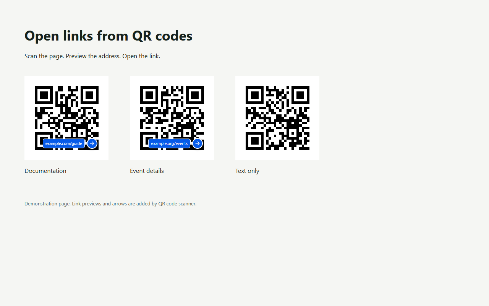

# QR code scanner

Scan QR codes on the current page, preview their links, and open a chosen link
in a new tab. No popup, settings, camera, account, or scan history.

Click the toolbar icon to enable scanning. A blue arrow and shortened URL appear
over each decoded web-link QR code. Hover for the full destination and click to
open it. Click the toolbar icon again, or press Escape, to stop scanning.

## Try scanning

After installing the extension, enable it on this page. Each of these example
QR codes should get a link preview. The two addresses are demonstration links.

Browser internal pages and protected store pages cannot be annotated. Blurry,
very small or partly hidden QR codes may not decode. Only HTTP(S) links open.

## Privacy and support

Screenshots are processed temporarily on your device. The scanner does not
upload or persist screenshots or decoded results. Opening a selected link uses
normal browser navigation. Read the full [privacy policy](PRIVACY.md).

For support, email **cyril.kong@gmail.com** or [open an issue](https://github.com/cyrilkong/qr-code-scanner-public/issues).
